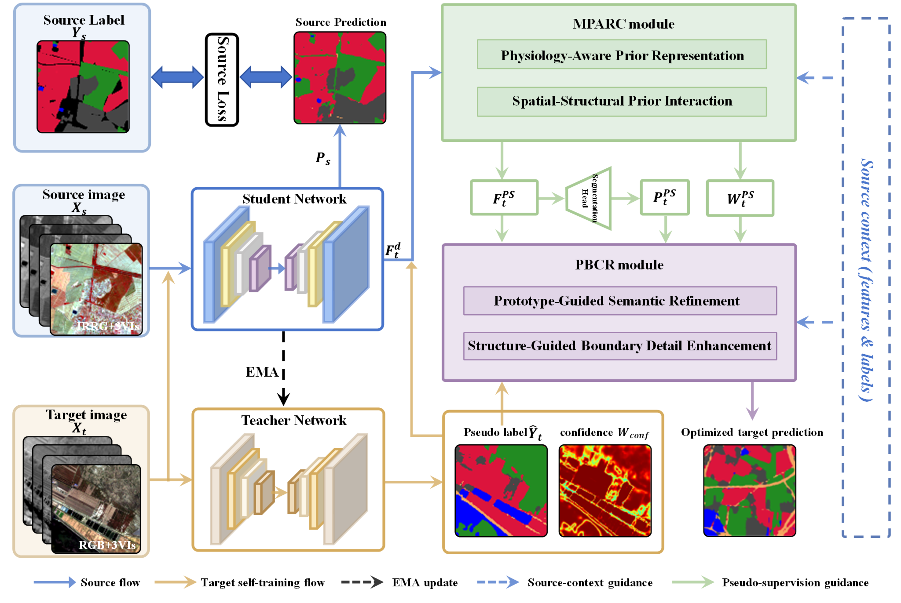
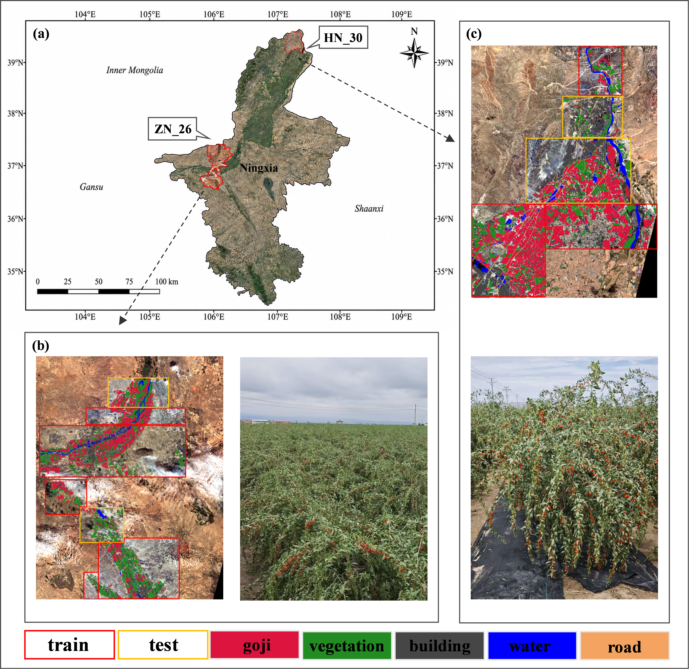

# PSSAL-DA

Official implementation of **PSSAL-DA**, a research framework for cross-domain semantic segmentation of goji cultivation areas from Sentinel-2 multispectral imagery.

<p align="center">
  
</p>

## Overview

PSSAL-DA explores task-aware representation learning and prediction refinement for unsupervised domain adaptation. It is designed to improve segmentation robustness under regional differences and changes in imaging modality.

This repository is an initial code release for a manuscript under review. The current README intentionally provides only a high-level description; detailed technical documentation will be added after the paper is accepted.

## NGMSeg

<p align="center">
  
</p>

NGMSeg is a multispectral semantic-segmentation dataset for goji cultivation areas in Ningxia, China. The dataset is not included in this initial repository. Access information will be provided in a later release.

## Quick Start

The environment follows the upstream HRDA implementation.

```bash
conda create -n pssal-da python=3.8.5 -y
conda activate pssal-da
pip install -r requirements.txt -f https://download.pytorch.org/whl/torch_stable.html
pip install mmcv-full==1.3.7
```

Launch the provided training entry point from the repository root:

```bash
bash train_pssal_da.sh
```

## Release Status

- Initial research-code release
- Dataset, checkpoints, and experimental results are not included
- Documentation and citation information will be updated after acceptance

## Acknowledgements

This project is developed on top of [HRDA](https://github.com/lhoyer/HRDA), [DAFormer](https://github.com/lhoyer/DAFormer), [DACS](https://github.com/vikolss/DACS), and [MMSegmentation](https://github.com/open-mmlab/mmsegmentation).

## License

The code is released under the [Apache License 2.0](LICENSE). Third-party notices are provided in [LICENSES.md](LICENSES.md).
