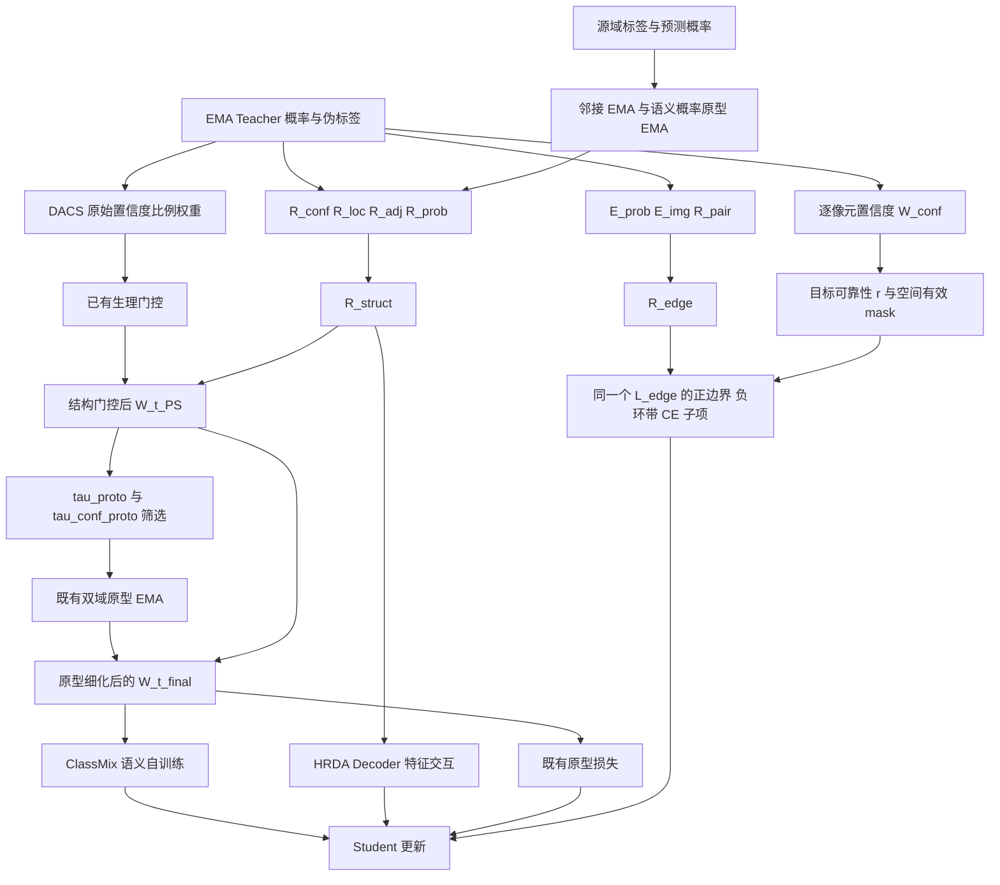

# 第一阶段方案与论文代码日志对照

> 当前日志与机制采集以 [最终整合版工程交付](doris_mechanism_collection_zh.md) 为准；下文保留此前方案的算法核查与阶段记录。

## Material Passport

本轮范围：用户确认的四个结构证据、三个边界证据、两个融合响应和一个边界损失，以及原型筛选阈值与过程日志。依据当前本地源码、20261105_202446.log、用户粘贴的确定方案、论文 PDF 第 6–11 页及审稿意见。状态为本地实现与轻量验证，不是 GPU 训练验收或精度提升证明；不修改论文 PDF、Word、插图，不开展参数搜索。

论文：[原文 PDF](/C:/Users/wyh/Desktop/小论文/PSSAL-DA_Sentinel2_Goji_Segmentation.pdf)。审稿意见：[中文文档](</C:/Users/wyh/Downloads/TGRS_PSSAL-DA_拒稿通知及审稿意见_完整中文翻译 (1).docx>)。

## 1 日志实际说明了什么

本地 Full 日志在目录 `shared-nvme/work_dirs/doris_stage1/goji30IRRG2goji26IRRG_hrda_3vi_proto_struct_edg/`，只记录到 **100 步**，没有首轮验证或错误堆栈。目录末尾缺少 e 是本地接收文件夹的名称；未因此修改云端 work_dir。日志表明预训练六通道骨干和四个现有模块已建立，不能由此断言后续训练已通过。

- 50→100 步，总 loss 约 1.2412→1.1363；当前信息未见 NaN/Inf。
- `loss_phy_src≈0.71` 是未乘系数的源域生理 BCE。实际贡献乘 `lambda_phy_src=0.08`，约 0.057；旧日志把原始值与已加权的其他 loss 并列，容易误读。新日志同时明确 raw 与 weighted。
- 边界损失不是在 5000 步前关闭，而是 `min(local_iter/5000,1)` 渐进增大。它还乘域系数、StructEdgeLoss 的 0.1 以及 HRDA 的尺度系数，早期可能小于四位小数显示精度。新日志将非零小 loss 显示为科学计数法。
- T1 的结构门控/特征交互从 6000 步开始，4000 步 ramp；目标原型更新从 8000 开始，原型权重和原型损失从 12000 开始。因此 100 步时原型损失为零合理。
- `loss_phy_tgt=0` 也可能是没有满足 0.968 置信度条件的目标植被候选；需要新的置信度/候选统计确认，不能仅凭零值判断断链。

## 2 本轮修正及实际链路



本轮没有新增网络分支或额外 Teacher/Student 前向。源域生理监督、原型损失及原型记忆是已有机制，不能因为创新表述收敛为“两响应一边界损失”就删去这些实际训练环节。

### 两个响应和一个损失

| 量 | 旧代码/论文情况 | 确定方案与当前实现 |
|---|---|---|
| R_struct | legacy 为四项幂乘积；PDF 式(9)是四项加权和，二者原本就不同 | `R_conf*(0.40*R_loc+0.30*R_adj+0.30*R_prob)`；未初始化/非有限的结构证据不参与加权，按实际可用分量重归一化，最终 [0,1] |
| R_pair | 原 DORIS 实现仍有旧幂变换和时间 ramp | `pair_response_mode=valid_boundary_only`：有效四邻域异类别先验均值；无异类邻居/先验未初始化则 0；忽略 255，不跨图像边缘，无底权、幂或额外 ramp；源域先验 EMA 不变 |
| R_edge | PDF 式(26)是三证据线性融合；原代码未就绪时会改变有效权重 | 目标域严格为 `0.45*E_prob+0.35*E_img+0.20*R_pair`，未就绪 R_pair 为 0；源域仅有影像证据时直接使用 E_img；E_img 只取基础三通道 |
| L_edge | legacy 边界 BCE/CE，允许原有 Dice 配置 | Full 使用 `0.1*(0.75*L_pos+0.25*L_neg+0.10*L_CE)`；正/负分别按有效样本数归一化；负样本为正边界外 3 像素局部环带；源/目标系数和 warmup 保留且只乘一次，不加 Dice/Focal |
| 目标可靠性 r | 不能混用最终伪标签权重 | `clamp((Teacher confidence-0.60)/0.35,0,1)`；detach；空间无效区和 ClassMix 人工缝排除；负环带接收邻近有效正边界的可靠性 |

`E_prob` 在当前训练中取 EMA Teacher 概率梯度，监督 Student。旧 PDF 图4/式(23)标为 MPARC 后预测 P_PS；在修订图文时需要明确这一 Teacher 固定目标的实现选择，不能声称二者数值完全相同。独立响应导出与训练共用融合方法，图中已改用 `R_loc`、`R_prob`；旧 NPZ 键保留为别名。

### 原型阈值

`ProtoGate` 现在直接使用 `tau_proto`、`tau_conf_proto`。历史 `target_weight_thr`、`target_conf_thr` 仍是兼容别名；新旧名称同时给不同非空值会报错。三个 Full 显式覆盖继承的旧别名为 None，统一 `tau_proto=0.25`、`tau_conf_proto=0.88`、`min_pixels=8`、`momentum=0.99`。

`DACS.forward_train` 在 MPARC 之后保存 `w_t_ps`，再调用 `update_target(..., w_t_ps)`，随后才计算 PBCR prototype weight 并得到 `w_t_final`。筛选在原型特征分辨率进行：标签 nearest resize，置信度/权重沿用原有 bilinear 对齐。候选需类别匹配、非 255、confidence≥0.88、w_t_ps≥0.25；满足数量至少 8 才更新，否则保留历史原型。无目标域 GT 输入。0.25 是固定候选值，尚未证明最优。

| 场景 | 目标原型更新开始 | 原型加权/损失开始 | lambda_proto_tgt | proto_min_weight / power | 边界源/目标系数 |
|---|---:|---:|---:|---|---|
| T1 30IRRG→26IRRG | 8000 | 12000 | 0.0003 | 0.95 / 0.35 | 0.006 / 0.003 |
| T2 26IRRG→30RGB | 8000 | 14000 | 0.0002 | 0.98 / 0.35 | 0.004 / 0.002 |
| T3 26RGB→30RGB | 3000 | 6000 | 0.001 | 0.88 / 0.70 | 0.010 / 0.006 |

三组 Full 都为 MiT-B5、6 通道、5 类、256×256、batch=2、20k；pseudo_threshold=0.968，gamma_struct=0.05，原数据划分/增强/评价/预训练来源保留。三个 Baseline 不启用这些机制，旧24组消融仍走 legacy。

## 3 论文符号代码配置日志对应

| 论文符号 | 代码变量/兼容接口 | 配置参数 | 新日志字段 | 实际作用 | 一致性 |
|---|---|---|---|---|---|
| R_conf / W_conf | teacher_target_confidence_map、conf_t | Teacher EMA，非 tau_proto | teacher.w_conf_mean；mparc.r_conf_mean | 逐像元 Teacher 最大概率 | 四证据中的置信度；不同于 DACS 批次权重 |
| R_loc | r_cont / R_continuity | continuity_weight=0.40 | mparc.r_loc_mean | 局部预测类别一致性 | 对应图3 Local Consistency |
| R_adj | r_adj / R_adj | adjacency_weight=0.30 | mparc.r_adj_mean、adj_ready_classes | 源域邻接 EMA 在目标预测上的响应 | 未初始化不能当有效证据 |
| R_prob | r_sem / R_sem | semantic_weight=0.30 | mparc.r_prob_mean、prob_ready_classes | 概率向量与源域类别概率原型的一致性 | 对应图3 Probability Similarity |
| R_struct | r_struct / R_struct | fusion_mode=doris_confidence_guided | mparc.r_struct_mean；schedule.struct_ramp | 权重调制及 HRDA 特征交互 | 对齐本次确定方案；PDF式(9)需更新 |
| W_t_phy | phy_pseudo_weight | 原 phy_cfg | mparc.w_t_phy_mean | 生理门控后权重 | 保留已有门控公式 |
| W_t_PS | w_t_ps | 原结构门控及 warmup | mparc.w_t_ps_mean | MPARC 后、PBCR 前，供原型筛选 | 阶段位置正确 |
| E_prob / E_img / R_pair | DACS 三个边界响应 | 0.45 / 0.35 / 0.20 | pbcr.tgt.e_prob_mean_boundary 等 | Teacher 概率梯度/基础影像梯度/有效异类类别对 | 三证据保留；概率输入来源见上文 |
| R_edge | responses[R_edge] | edge_fusion_mode=doris_reliable | pbcr.tgt.r_edge_mean_boundary | 目标固定边界可靠性，源域只用 E_img | 对齐确定方案 |
| L_edge | 内部 loss_struct_edge | boundary_loss_mode=doris_balanced | source.loss_edge、mix.loss_edge；各有 hr 项 | 同一边界损失在两个 HRDA 尺度和源/混合样本上的计算 | 子项不是新增独立损失 |
| L_pos / L_neg / L_CE | loss_edge_pos / neg / ce | positive_weight=.75、negative_weight=.25、ce_weight=.10 | pbcr.source.loss_edge_pos/neg/ce；mix、hr 同理 | 已计域权重、ramp、loss_weight 和尺度系数的贡献 | 仅快照诊断，不重复反传或计总和 |
| tau_proto | ProtoGate.tau_proto | tau_proto=.25 | pbcr.tau_proto | w_t_ps 的筛选下限 | 式(16)阈值映射明确 |
| tau_conf_proto | ProtoGate.tau_conf_proto | tau_conf_proto=.88 | pbcr.tau_conf_proto | 独立 Teacher 置信度门槛 | 与 .968 分开 |
| W_t_final | pseudo_weight 在 proto_weight 后 | 原 proto_cfg | pbcr.w_t_final_mean；每类 w_t_final_mean | 最终 ClassMix/原型监督权重 | 与 w_t_ps 分开 |
| L_s / L_pst | 内部 decode.loss_seg / mix.decode.loss_seg | 原 HRDA CE 与 HR loss=.1 | source.loss_seg、mix.loss_pseudo；对应 hr 项 | 源域 CE / DACS ClassMix 语义 CE | mix 含源GT与目标伪标签，不能叫纯目标 CE |
| L_proto | loss_proto_tgt | lambda_proto_tgt、loss_start | pbcr.loss_proto_target | 已乘系数的原型项 | 不是边界正负子项 |
| L_phy | loss_phy_src、loss_phy_tgt | lambda_phy_src=.08、lambda_phy_tgt=.008 | mparc.loss_phy_source_raw / loss_phy_source / loss_phy_target | 源域生理监督与目标辅助项 | 旧PDF总目标未明确列源域生理 BCE，需要补充解释 |
| 总目标 | DACS.train_step 统计 | 各既有 loss 系数 | loss_total | 已实际 backward 的分项贡献总和 | raw 生理 BCE 先乘 .08，诊断子项排除 |

内部训练 loss key 保持不变；新命名只在 Full 的 Logger 展示/JSON 写出阶段生效，不影响 MMSeg 收集损失或 checkpoint。四个结构/三个边界证据不是七个新损失。源域和混合域分别出现 fused/hr 项，是 HRDA 原有多分辨率监督，不能据此数出多个 PBCR 创新损失。

## 4 默认过程日志和如何阅读

三个 Full 默认 `doris_process_logging=True`、`doris_log_interval=1000`，Logger `paper_names=True`、`process_interval=1000`。损失/Acc 仍每 50 步输出。只新增标量，不默认写过程图片。

每 1000 步记录当前 batch 快照，不是假称跨 1000 步平均。Logger 使用该次快照的最新值，不将此前稀疏快照按 batch 平均，也不在非采样行重复显示旧值。验证日志的 iter 改为实际训练步数；验证 batch 数另记 `eval_batches`，不会每次都把 314 张验证图误标成“第314步”。

- `teacher`：逐像元 confidence 均值、DACS 全图高置信比例、裁边后有效面积、各类预测比例。有效面积不是置信度保留比例。
- `mparc`：四个结构分量、R_struct、可用先验类数、w_t_phy/w_t_ps，以及生理项的 raw/weighted 区别。
- `schedule`：结构 ramp、计划特征注入强度、边界 ramp、原型加权/损失的时间启用状态。时间启用不等于已有可用原型或非零梯度，仍应结合类状态、样本数和实际 loss。
- `pbcr.proto.goji` 等五类：候选比例/数量、置信度通过比例、w_t_ps 通过比例、联合 selected 比例/数量、达到 min_pixels 后的 updated_count、源/目标原型 ready 状态。计数位于原型特征网格，不是原始256×256像元数；通过/selected 比例以该类候选为分母，candidate_ratio 以特征网格为分母。
- `pbcr.src/tgt`：边界证据及融合响应在有效边界上的均值、目标可靠性；响应存在但无有效边界时相应均值为0，应结合样本数量解读。
- `pbcr.source`：基于源GT的局部边界 precision/recall/F1，固定归一化梯度阈值0.5，在正边界与邻近3像素负环带上统计。它是训练 batch 诊断，不是标准化全图 BFScore。
- `pbcr.mix`：同一统计相对于混合标签，其中含 Teacher 伪标签，名称带 `_pseudo_agreement`；**不是目标GT边界精度**。零有效样本时安全记0，结合 positive_count/negative_count。
- 验证仍输出五类 IoU、mIoU、Veg.mIoU、NonVeg.mIoU。模块是否改善目标精度要由这些验证结果、后续固定样本可视化和消融比较支持；响应均值上升不等于性能提升。

如暂时只保留简洁损失输出，可在原命令后加 `--options uda.doris_process_logging=False`。关闭后仍保留清晰的 loss 命名，但不采集模块诊断。

## 5 已明确列出但本轮不擅改的旧论文实现差异

为遵守用户方案“不改变原型提取、融合、相似度、原型损失公式”和“保留 HRDA baseline 行为”的边界，本轮不靠改名掩盖以下差异，也不擅自重写这些历史算法：

1. PDF式(7)的 W_conf 是逐像元最大概率；DACS 语义自训练起始权重实际是整个 batch 满足0.968的像元比例，再作空间裁边。日志明确区分 w_conf_mean 和 dacs_high_conf_ratio_all。相应论文权重定义需要与既有 HRDA/DACS 实现核对。
2. PDF式(17)写目标原型按 W_t_PS 加权聚合；当前 ProtoGate 在筛选后按候选特征等权平均。式(14)–(22)还描述了解码特征/共享投影、softmax 概率 margin 与加性细化，当前代码用 backbone 特征、cosine top-two margin、带底权的乘性 proto_weight。它们不能仅通过把 target_weight_thr 改成 tau_proto 就被宣称完全一致。本轮只修正筛选阈值和 W_t_PS 输入位置，保留已有原型数学；之后应单独决定以哪一版公式/实现为准。
3. PDF式(29)目标 CE 的权重和归一化与 HRDA/DACS 的 ClassMix CE 不是逐式相同；本轮保留可比的原基础训练协议。
4. 两响应与新 balanced L_edge 是本次确定的修订方案，不是旧 PDF 所有公式的逐字复现。图3/4总体连线可继续使用，但融合框内公式、Teacher/Student来源、损失入口和原型选择条件应在后续修订图文时同步；本轮不编辑论文和插图。

这些差异主要对应审稿人1第2、6、7、8点以及审稿人2关于创新边界/过程证据的疑问。本轮补充的是可核查机制与观测接口，不声称已经以新实验回答全部审稿意见。

## 6 同步文件和运行

需要同步的源码：`mmseg/models/uda/{dacs,proto_gate,struct_prior_gate}.py`、`mmseg/models/losses/struct_edge_loss.py`、`mmseg/models/decode_heads/{decode_head,hrda_head}.py`、`mmseg/utils/precision_logger.py`。同时同步三个现有 doris_ Full 配置。若此前未同步分组指标改动，也同步 `mmseg/datasets/goji.py`；mask 链路已修正的 segmentor 源码也要与本地保持一致。

辅助工具：`tools/check_doris_stage1_configs.py`、`tools/export_doris_response_maps.py`。新增测试：`tests/test_doris_paper_logging.py`；更新了受新模式影响的 `tests/test_doris_stage1.py` 断言。

原命令不变，例如 T1 Full：

```bash
python tools/train.py configs/hrda/doris/goji30IRRG2goji26IRRG/doris_goji30IRRG2goji26IRRG_hrda_3vi_proto_struct_edge.py --work-dir /root/shared-nvme/work_dirs/doris_stage1/goji30IRRG2goji26IRRG/goji30IRRG2goji26IRRG_hrda_3vi_proto_struct_edge
```

其余五组：

```bash
python tools/train.py configs/hrda/doris/goji30IRRG2goji26IRRG/doris_goji30IRRG2goji26IRRG_hrda_3vi.py --work-dir /root/shared-nvme/work_dirs/doris_stage1/goji30IRRG2goji26IRRG/goji30IRRG2goji26IRRG_hrda_3vi
python tools/train.py configs/hrda/doris/goji26IRRG2goji30RGB/doris_goji26IRRG2goji30RGB_hrda_3vi.py --work-dir /root/shared-nvme/work_dirs/doris_stage1/goji26IRRG2goji30RGB/goji26IRRG2goji30RGB_hrda_3vi
python tools/train.py configs/hrda/doris/goji26IRRG2goji30RGB/doris_goji26IRRG2goji30RGB_hrda_3vi_proto_struct_edge.py --work-dir /root/shared-nvme/work_dirs/doris_stage1/goji26IRRG2goji30RGB/goji26IRRG2goji30RGB_hrda_3vi_proto_struct_edge
python tools/train.py configs/hrda/doris/goji26RGB2goji30RGB/doris_goji26RGB2goji30RGB_hrda_3vi.py --work-dir /root/shared-nvme/work_dirs/doris_stage1/goji26RGB2goji30RGB/goji26RGB2goji30RGB_hrda_3vi
python tools/train.py configs/hrda/doris/goji26RGB2goji30RGB/doris_goji26RGB2goji30RGB_hrda_3vi_proto_struct_edge.py --work-dir /root/shared-nvme/work_dirs/doris_stage1/goji26RGB2goji30RGB/goji26RGB2goji30RGB_hrda_3vi_proto_struct_edge
```

不覆盖/删除历史结果，不自动 resume。算法阈值和 pair 响应已改变，不应把修改前后过程混称同一协议。本次没有执行这些训练命令。

## 7 验收边界

真实 MMCV 1.4.0 Config.fromfile 已解析核查32个有效配置（24历史+6 HRDA/Full+2已有对比），仅关闭依赖训练栈的 runtime custom_imports。配置核查 JSON 和三组 Full 有效配置保存于本地 `outputs/doris_revision_audit/`，不作为训练结果。

30项针对性轻量检查通过：训练组件环境先通过28项，另2项因环境依赖跳过，随后在已有文档/配置环境补验通过；没有把跳过计为成功。检查覆盖新旧阈值别名/冲突、0.25与0.88联合筛选、7/8像元更新门槛、时序前仅候选不更新、R_pair无幂/无ramp、空边界和ignore、ClassMix seam、外部权重缩放/梯度、边界诊断子项之和与总损失不重复计数、稀疏快照不复用旧值、验证训练步数、HRDA mask接口及legacy数值/梯度兼容。Python 3.8 compileall及git diff --check通过。本轮未安装依赖、未连接GPU、未自动commit/push。

云端仍需确认：真实FP16多尺度训练与checkpoint恢复；1000步验证记录及分组IoU；6000/8000/12000等阶段的真实候选数、原型类状态和非零损失；固定checkpoint响应图。特别关注 tau_proto=0.25 后候选是否仍长期不足8，而不要仅依据 loss 曲线作结论。
